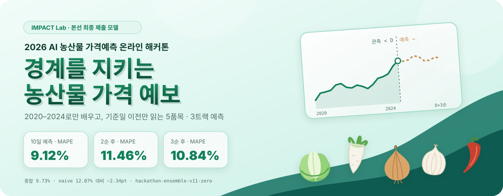
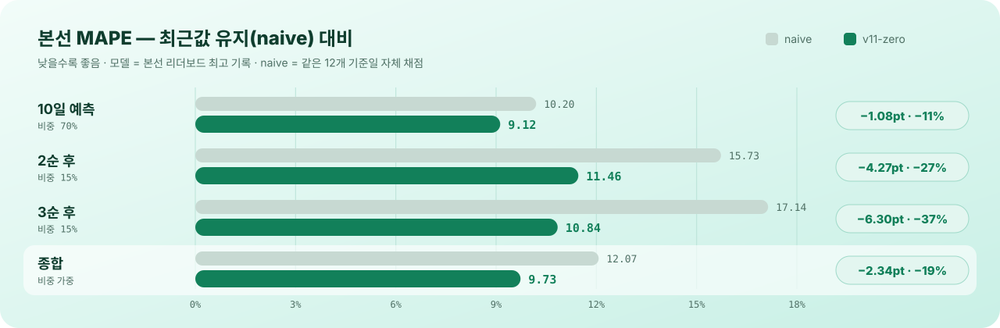
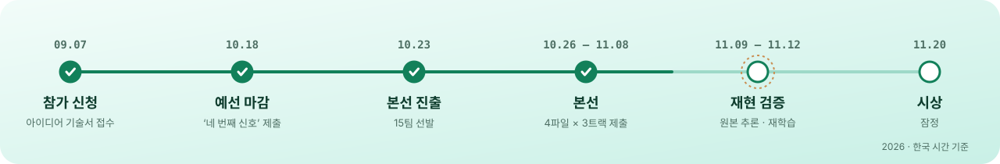
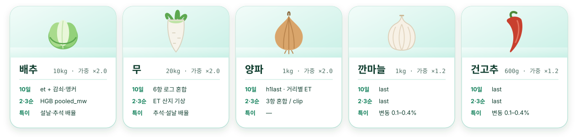
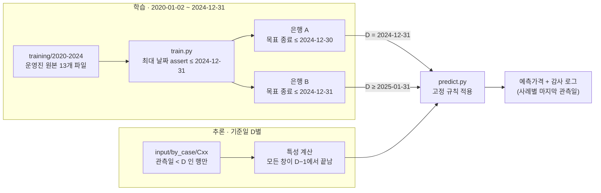
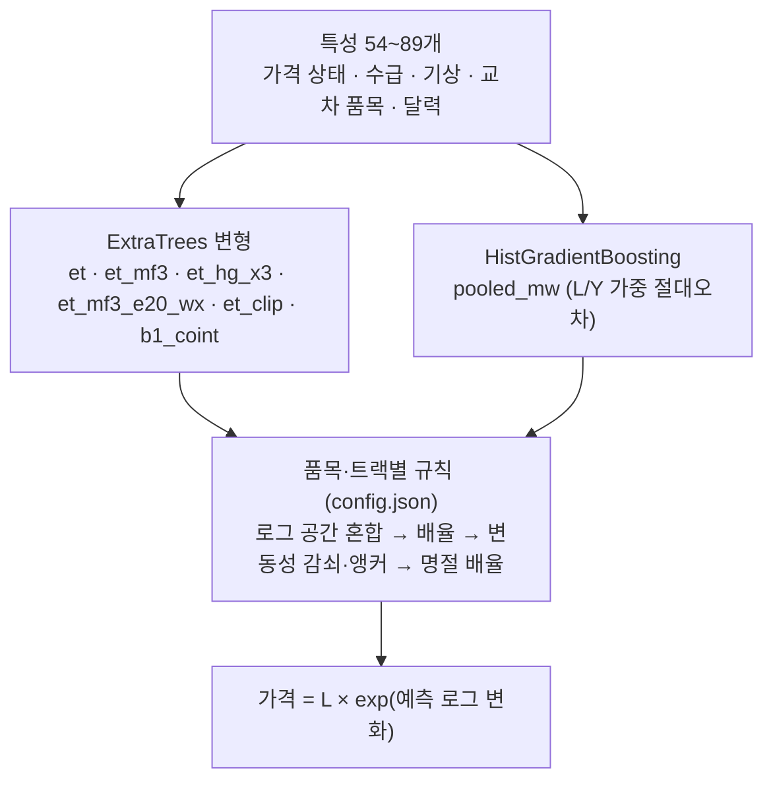

<div align="center">

<picture>
  <source media="(prefers-color-scheme: dark)" srcset="assets/banner-dark.svg">
  
</picture>

<h1>🌾 2026 AI 농산물 가격예측 온라인 해커톤</h1>

<p><b>HarvestCast</b> (Harvest + Forecast) — 허용된 과거만 보고, 기준일 이전만 읽는 농산물 가격 예보</p>

[](#-본선-리더보드)
[](model/requirements.txt)
[](model/requirements.txt)
[](#-재현하기)
[](docs/REPRODUCIBILITY.md)
[](https://hackathon.imaginationgroup.co.kr/nongnet)

**본선 최종 제출 모델 · Team IMPACT Lab**<br/><sub>Maximiliano Islas Solis (Team Leader) · 박준 · 최연규 — with thanks to <a href="https://impact.gist.ac.kr/main/main.php">GIST IMPACT Lab</a></sub>

배추 · 무 · 양파 · 깐마늘 · 건고추의 **10일 일별 가격**과 **2순 후 · 3순 후 순 평균가격**을 예측하는 모델입니다.<br/>
2020–2024년 자료로만 학습하고, 각 기준일 **이전** 관측만 읽도록 데이터 구조 자체로 경계를 강제했습니다.

**[팀](#-팀)**&nbsp;&nbsp;·&nbsp;&nbsp;**[리더보드](#-본선-리더보드)**&nbsp;&nbsp;·&nbsp;&nbsp;**[결과](#-결과)**&nbsp;&nbsp;·&nbsp;&nbsp;**[대회](#-대회와-과제)**&nbsp;&nbsp;·&nbsp;&nbsp;**[핵심 아이디어](#-핵심-아이디어)**&nbsp;&nbsp;·&nbsp;&nbsp;**[데이터와 경계](#-데이터와-미래-정보-차단)**&nbsp;&nbsp;·&nbsp;&nbsp;**[모델](#-모델)**&nbsp;&nbsp;·&nbsp;&nbsp;**[검증](#-20222024-전진-검증)**&nbsp;&nbsp;·&nbsp;&nbsp;**[재현하기](#-재현하기)**&nbsp;&nbsp;·&nbsp;&nbsp;**[문서](#-문서)**

</div>

---

## 👥 팀

<div align="center">

**Team IMPACT Lab** · 2026 AI 농산물 가격예측 온라인 해커톤 본선

<br/>

<table>
  <tr>
    <td align="center" valign="middle" width="33%"></td>
    <td align="center" valign="middle" width="33%"></td>
    <td align="center" valign="middle" width="33%"></td>
  </tr>
  <tr>
    <td align="center" valign="middle" width="33%"><h3>Maximiliano Islas Solis</h3><b>⭐ Team Leader</b></td>
    <td align="center" valign="middle" width="33%"><h3>박준</h3><b>John Park</b></td>
    <td align="center" valign="middle" width="33%"><h3>최연규</h3><b>Yeonkyu Choi</b></td>
  </tr>
  <tr>
    <td align="center" valign="middle" width="33%">M.S. Course · <a href="https://impact.gist.ac.kr/team/students.php">GIST IMPACT Lab</a></td>
    <td align="center" valign="middle" width="33%">M.S. Course · <a href="https://impact.gist.ac.kr/team/students.php">GIST IMPACT Lab</a></td>
    <td align="center" valign="middle" width="33%">M.S. Course · <a href="https://impact.gist.ac.kr/team/students.php">GIST IMPACT Lab</a><br/>Korea Aerospace Research Institute</td>
  </tr>
  <tr>
    <td align="center" valign="middle" width="33%">Data Analysis &amp; ML<br/>Econometrics</td>
    <td align="center" valign="middle" width="33%">Semiconductor &amp; Financial<br/>Data Forecasting<br/>AI Strategy &amp; Data Analytics</td>
    <td align="center" valign="middle" width="33%">Agricultural Production Analysis<br/>Earth Environment</td>
  </tr>
  <tr>
    <td align="center" valign="middle" width="33%"><a href="https://github.com/MaximilianoIS"><b>@MaximilianoIS</b></a></td>
    <td align="center" valign="middle" width="33%"><a href="https://github.com/parkjohn10277"><b>@parkjohn10277</b></a></td>
    <td align="center" valign="middle" width="33%"><a href="https://github.com/dkrh2539"><b>@dkrh2539</b></a></td>
  </tr>
</table>

</div>

---

> [!NOTE]
> `model/`의 코드와 `tracks/`의 설정·가중치는 본선에 제출한 `v11_zero_linux` 묶음과 **바이트 단위로 동일**하며, 운영진 배포 데이터는 재배포하지 않습니다([data/README.md](data/README.md)).

## 📌 한눈에 보기

| | 10일 예측 | 2순 후 | 3순 후 | **종합** |
|:--|:--:|:--:|:--:|:--:|
| 평가 비중 | 70% | 15% | 15% | 가중 합 |
| 예측 개수 | 12 기준일 × 10일 × 5품목 = 600 | 12 × 5 = 60 | 12 × 5 = 60 | |
| **본선 리더보드 MAPE** | **9.1231%** | **11.4627%** | **10.8410%** | **9.7317%** |
| 최근값 유지(naive) | 10.20% | 15.73% | 17.14% | 12.07% |
| naive 대비 | −1.08pt | −4.27pt | −6.30pt | −2.34pt |
| **본선 잠정 순위** | **2위** / 15팀 | **2위** / 15팀 | **2위** / 15팀 | **🥈 2위** / 15팀 |

<sub>리더보드 수치는 2026-11-08 본선 포털의 모델별 최고 기록입니다(제출 ID `efb84521` · `8a444125` · `89502728`). naive는 같은 12개 기준일을 대회 산식으로 자체 채점한 값입니다. 순위는 2026-11-10 리더보드 기준 잠정 순위이며, 최종 순위는 운영진 재현 검증과 이의신청 처리 후 확정됩니다.</sub>

## 🏅 본선 리더보드

본선 15팀 중 **종합 잠정 2위**이며, 10일 예측·2순 후·3순 후 **세 트랙 모두 2위**입니다. 운영진은 검증을 마친 뒤 리더보드 상위 5팀을 대상으로 발표와 시상식을 진행합니다.

| 순위 | 팀 | 종합 MAPE | 10일 예측 | 2순 후 | 3순 후 |
|:--:|:--|--:|--:|--:|--:|
| 1 | 천재원 | 8.7174% | 8.7643% | 8.8317% | 8.3843% |
| **🥈 2** | **IMPACT Lab** | **9.7317%** | **9.1231%** | **11.4627%** | **10.8410%** |
| 3 | 이준영 | 10.3158% | 9.3273% | 12.8600% | 12.3846% |
| 4 | 이동규 | 10.5462% | 9.6083% | 13.4281% | 12.0410% |
| 5 | 양지훈 | 10.6071% | 9.5275% | 13.2757% | 12.9767% |
| 6 | 42 | 10.6738% | 9.6380% | 14.0694% | 12.1121% |
| 7 | 김홍진 | 10.6845% | 9.5390% | 13.3470% | 13.3677% |
| 8 | 박도현 | 10.7305% | 9.4414% | 13.8626% | 13.6138% |
| 9 | 랜덤포레스트 풍년맞이 | 10.8938% | 9.8871% | 13.1958% | 13.2892% |
| 10 | 농구벌레들 | 11.2800% | 9.8386% | 14.4450% | 14.8419% |
| 11 | 이완우 | 11.3208% | 9.9690% | 13.8953% | 15.0551% |
| 12 | 이동현 | 11.3664% | 9.9709% | 14.8334% | 14.4120% |
| 13 | 김준수 | 11.3802% | 10.1631% | 13.9806% | 14.4592% |
| 14 | 최우영 | 11.4641% | 9.9242% | 14.8496% | 15.2649% |
| 15 | 황대연 | 11.7254% | 10.2073% | 14.9842% | 15.5511% |

<sub>출처: <a href="https://hackathon.imaginationgroup.co.kr/nongnet/leaderboard">대회 리더보드</a> (2026-11-10 확인, 모델별 최고 기록으로 계산한 잠정 순위). 종합 = 10일 70% · 2순 후 15% · 3순 후 15%.</sub>

## 📈 결과

<div align="center">
<picture>
  <source media="(prefers-color-scheme: dark)" srcset="assets/results-dark.svg">
  
</picture>
</div>

- **장기 트랙에서 차이가 가장 컸습니다.** 2순 후 −4.27pt, 3순 후 −6.30pt로 naive 오차를 각각 27%, 37% 줄였습니다.
- **10일 예측은 노이즈 바닥이 높습니다.** 배추·무의 하루 가격 변동 중앙값이 6–8%라 10일 평균 수준을 완벽히 알아도 일별 MAPE가 약 6% 남습니다. 모델이 기여할 수 있는 폭은 naive 10.2%와 그 사이입니다.
- **깐마늘·건고추는 최근값 유지가 최적이었습니다.** 10일 사이 가격 변동 중앙값이 0.1–0.4%라 세 트랙 모두 `last` 규칙으로 고정했습니다.

## 🏆 대회와 과제

<div align="center">

<br/><sub>2026 AI 농산물 가격예측 온라인 해커톤 · 주최 농림축산식품부 · 한국농수산식품유통공사(aT) · 주관 상상력집단 · <a href="https://hackathon.imaginationgroup.co.kr/nongnet">대회 페이지</a></sub>
</div>

<br/>

<picture>
  <source media="(prefers-color-scheme: dark)" srcset="assets/timeline-dark.svg">
  
</picture>

| 항목 | 내용 |
|:--|:--|
| 트랙 | **10일 예측** — 기준일 다음 날부터 10일간 일별 가격 · **2순 후 / 3순 후** — 상순(1–10일)·중순(11–20일)·하순(21일–말일) 단위 평균가격 |
| 기준일 | 2024-12-31 ~ 2025-11-30 월말 12개 |
| 지표 | 품목 가중 MAPE (배추·무·양파 2, 깐마늘·건고추 1.2), 종합 = 70 / 15 / 15 |
| 핵심 규정 | 학습·튜닝·모델 선택은 2020–2024 자료로만. 2025 자료는 각 기준일 **이전** 관측을 추론 입력으로만 사용 |

<picture>
  <source media="(prefers-color-scheme: dark)" srcset="assets/items-dark.svg">
  
</picture>

## 💡 핵심 아이디어

<table>
<tr>
<td width="33%" valign="top">

**① 수준이 아니라 변화율을 배운다**

목표를 `log(목표가격 / L) − EWMA 기준`으로 두어 품목 간 가격 규모 차이를 없애고, 다섯 품목을 **하나의 은행**에서 함께 학습합니다(품목 더미 포함). 품목당 수천 행의 자료를 5배로 늘리는 효과가 있습니다.

</td>
<td width="33%" valign="top">

**② 경계는 코드가 아니라 데이터 구조로**

"날짜 필터를 넣었다"는 설명 대신, 기준일별 입력 폴더(`by_case/C01…C12`)에 **그 날짜 이전 행만 물리적으로** 저장했습니다. 정답 가격은 입력 ZIP 안에 존재하지 않습니다.

</td>
<td width="33%" valign="top">

**③ 추론 중에는 아무것도 배우지 않는다**

모든 혼합비율·배율·감쇠 계수·명절 배율은 `config.json`에 고정합니다. 추론 중 재학습, 잔차 피드백, 온라인 가중 갱신이 없어 새 기준일에도 같은 절차가 그대로 적용됩니다.

</td>
</tr>
</table>

## 🧱 데이터와 미래 정보 차단

운영진이 배포한 공식 자료 7종만 사용했습니다. 외부 데이터, 사전학습 모델, 예보 자료는 쓰지 않았습니다.

| 자료 | 파일 | 모델에서의 역할 |
|:--|:--|:--|
| aT 일별 경락가격 | `가격_일별` (목표와 동일) | 마지막 가격 L, EWMA 기준, 수익률·변동성·계절 |
| 전국 도매시장 정산물량 | `물량_일별` | 물량 비율(7/30일, 전년 대비) |
| 농협 산지공판장 | `origin_daily` (상등급) | 산지 가격·반입량 비율 |
| 가락시장 정산 | `garak_daily` / `settlement_daily` | 가락 정산단가·물량 비율 |
| 전국 도매시장 정산 | `wholesale_daily` / `settlement_daily` | 전국 정산단가·물량, 상승일 비율 |
| 기상청 ASOS 일별 관측 | `weather_daily` | 14·30일 기온·강수 이상, 산지 권역, 서리·폭염·호우 |
| 법정 공휴일 달력 | `public_holidays` | 설날·추석 휴장 구간 보정(사전 확정 달력) |



- 모든 특성 창(7·14·30·365일, 전년 동기)은 `D−1`에서 끝납니다. 예: "최근 14일"은 항상 `D−14 ~ D−1`입니다.
- 사례별 `input-manifest.json`에 파일마다 관측 기간·행 수·SHA-256과 원본 파일 해시를 기록했습니다.
- 공휴일은 관측값이 아닌 사전 확정 달력이라, 기준일 이후의 명절 날짜도 보정 규칙에 사용합니다. 2025 달력은 운영진 원본 20행 그대로입니다.

## 🌲 모델

**구조.** 5품목 풀링 트리 은행 위에 품목·트랙별 고정 규칙을 얹은 2단 구조입니다.



<details>
<summary><b>특성 네 갈래</b> (클릭해서 펼치기)</summary>

| 갈래 | 내용 |
|:--|:--|
| 가격 상태 | 마지막 가격 L · EWMA e20/e50(평활계수 0.2/0.5) · 3–365일 수익률 · 7/14/30일 모멘텀 · vol30/vol90 · 60/180일 범위 위치 · 전년 동기 이상치 · 과거 동일 시기 로그 변화(seas, seas_med) |
| 수급 | 도매시장 정산물량 7/30/365일·전년 비율 · 산지공판장 상등급 가격·반입량 · 가락·전국 정산단가 대비 L · 정산물량 변화 · 마지막 두 순 블록 평균 |
| 기상 | 전국 평균 14·30일 기온·강수와 전년 대비 이상 · 서리·폭염·호우 일수 · 산지 권역(고랭지·전남·충청·전북·경남·제주) 기온·강수·일조 |
| 교차 품목 | 배추·무·양파의 모멘텀·이상치 공유 · 배추-무, 배추-양파, 무-양파 스프레드(공적분형 변수) · 요일·연중 일자 · 예측 거리 h |

</details>

**품목·트랙별 규칙** — 모두 [`tracks/*/config.json`](tracks/short/config.json)에 고정되어 있습니다.

| 품목 | 10일 예측 (`short`) | 2순 후 (`long1`) | 3순 후 (`long2`) |
|:--|:--|:--|:--|
| 배추 | `et` + 변동성 감쇠(λ 0.1) + ewma50·계절 앵커(w 0.25) | `pooled_mw+ewma+seas` × 0.9442 | `pooled_mw+ewma+seas` × 0.9261 |
| 무 | 6항 로그 혼합(`et`·`et_mf3`·`et_hg_x3`·`pooled_mw` +block, `b1_coint`×2) + 감쇠(λ 0.75) × 0.9813 | `et_mf3_e20_wx`(산지 기상) × 0.9553 | `et_mf3_e20_wx+ewma50` × 0.9387 |
| 양파 | `h1last_et_hg_e20_x3` × 1.0086 | `et｜et+block｜et+ewma+seas` × 0.9827, 변동성 수축 0.25 | `et_clip` × 0.9773 |
| 깐마늘 | `last` | `last` | `last` |
| 건고추 | `last` | `last` | `last` |

- **혼합(A|B)** — 로그 공간 동일 가중 평균입니다. 중복 항은 그만큼 가중되어 10일 무의 `b1_coint` 비중은 2/6입니다.
- **배율(shrink)** — 2022–2024 폴드 잔차 r에서 `exp(−var r)`, `exp(−½ var r)`, `exp(−mean r)`로 계산한 고정값입니다.
- **변동성 감쇠** — `plog −= λ · vol30² · h/10`. 변동이 크고 예측 거리가 멀수록 기준 수준 쪽으로 당깁니다. 학습된 칼만 필터가 아닌 고정 규칙입니다.

<details>
<summary><b>설날·추석 보정</b></summary>

명절·인접 공휴일·일요일을 합친 **휴장 구간의 경계**에서 날짜 오프셋을 셉니다. 배율은 2022–2024 폴드의 명절 전후 평균 로그 잔차로 계산했습니다(10일 `exp(0.75 × 평균)`, 2순 설날 무 `exp(0.50 × 평균)`).

| 규칙 | 배율 | 명절 구간 MAPE (2022–2024) |
|:--|:--:|:--|
| 10일 · 설날 휴장 후 1–5일 배추 | × 1.1365 | 16.62 → 8.69 (−7.93pt) |
| 10일 · 추석 휴장 1일 전 배추 | × 1.2276 | 23.17 → 19.34 (−3.83pt) |
| 10일 · 추석 휴장 3일·1일 전 무 | × 1.0985 | 17.78 → 16.97 (−0.81pt) |
| 2순 · 설날 포함 순 ~ +2순 무 | × 1.1159 | 22.85 → 14.28 (−8.57pt) |

<sub>개선폭은 해당 명절 부분집합(16–60행)의 값이며 트랙 전체 점수 변화가 아닙니다.</sub>

</details>

| 학습 규모 | 값 |
|:--|:--|
| 학습 기준일 격자 | 2020-07-01 ~ 2024-12-30, 매일 |
| 10일 은행 학습 행 | 63,209 |
| 장기 은행 학습 행 | 약 8,000 |
| 가중치 크기 | 10일 6.0MB · 2순 1.5MB · 3순 1.5MB |
| 시드 | `random_state=0` (모든 추정기) |

## 🔬 2022–2024 전진 검증

2020–2024 자료 안에서 연도별 확장 창으로 검증했습니다. 폴드 2022는 2021-12-31까지 끝나는 목표로 학습해 2022년 기준일을 평가하고, 2023·2024도 같은 방식입니다. 2024-12-31 이후에 끝나는 목표는 0행입니다.

| 품목 | 10일 예측 | 2순 후 | 3순 후 |
|:--|:--:|:--:|:--:|
| 배추 | **15.08** (19.95) | **21.21** (27.58) | **25.07** (35.39) |
| 무 | **15.52** (17.89) | 18.51 (18.09) | **21.86** (22.77) |
| 양파 | **8.50** (10.27) | 12.34 (11.95) | 14.54 (13.19) |
| 깐마늘 | **0.53** (0.97) | **1.25** (1.65) | **1.59** (1.99) |
| 건고추 | **1.03** (1.64) | **2.00** (2.10) | **2.48** (2.69) |

<sub>모델 MAPE(%), 괄호는 직전 순 블록 평균 유지(block) 기준선. 굵은 글씨는 기준선보다 나은 칸. 평가 행 수: 10일 1,776(깐마늘 1,432·건고추 1,422), 장기 215–216. 검증 기준일은 2020-07-10부터 10일 간격 + 설날·추석 휴장 35일 전~5일 후 2일 간격입니다. 출처: <a href="model/validation_2020_2024.json"><code>validation_2020_2024.json</code></a></sub>

> [!IMPORTANT]
> 배율 계산과 조정 후 점수에 같은 폴드를 썼기 때문에 이 표는 독립적인 일반화 성능 추정치가 아닙니다. 또 이 검증 스크립트는 **고정된 최종 설정**을 평가하고 수치 계산식을 확인할 뿐, 후보 방법·창·혼합비율의 최초 탐색 과정을 재현하지는 않습니다. 자세한 내용은 [docs/VALIDATION.md](docs/VALIDATION.md)에 있습니다.

## ♻️ 재현하기

**요구 사항** — CPython 3.14.8(일반 GIL 빌드) 권장, CPU만, 메모리 2GB 이상, 네트워크 불필요(패키지 설치 후).

```bash
git clone https://github.com/parkjohn10277/2026-AI-Agriculture-Price-Forecast-Hackathon.git
cd 2026-AI-Agriculture-Price-Forecast-Hackathon
python -m pip install -r model/requirements.txt

# 대회 제출 묶음(v11_zero_linux 폴더 또는 .zip)에서 데이터 배치 → data/ (git 제외)
make data BUNDLE=/path/to/v11_zero_linux.zip

make predict     # 제출 가중치로 세 트랙 추론 (트랙당 15–25초)
make verify      # 제출 예측값과 비교
```

`make verify`의 기대 출력입니다.

```text
short   600/600 prices identical  max diff 0.000%  sha256 match
long1   60/60 prices identical  max diff 0.000%  sha256 match
long2   60/60 prices identical  max diff 0.000%  sha256 match
```

```bash
make retrain           # 2020–2024로 처음부터 학습 후 세 트랙 예측 (약 2–4분)
make verify-retrained  # 재학습 예측과 제출값 비교
make validate          # 2022–2024 전진 검증 재계산 → JSON과 대조
```

| 확인 환경 | 저장 가중치 추론 | 처음부터 재학습 |
|:--|:--|:--|
| Linux x86_64 · Ubuntu 24.04(WSL2) · CPython 3.14.8 (가중치 생성 환경) | 600/60/60 일치 | 600/60/60 일치, 반복 시 가중치 바이트 동일 |
| macOS 13 · Apple Silicon · Python 3.12 · 같은 패키지 버전 | 600/60/60 일치 | 10일 600/600 · 2순 49/60 · 3순 47/60 (배추 최대 1.3%) |

<sub>CPU가 다르면 HistGradientBoosting 은행(pooled_mw)의 히스토그램 구간 분할이 부동소수점 차이로 달라져 장기 배추 예측이 소폭 바뀝니다. 같은 머신에서는 바이트 단위로 같습니다. 자세한 내용은 <a href="docs/REPRODUCIBILITY.md">docs/REPRODUCIBILITY.md</a>.</sub>

## 🗂 저장소 구조

```text
2026-AI-Agriculture-Price-Forecast-Hackathon/
├── model/                      # 제출 코드 (v11_zero_linux 10일 패키지와 동일, 수정 없음)
│   ├── train.py                #   2020–2024 은행 학습 (은행 A/B)
│   ├── predict.py              #   기준일별 추론 + 고정 규칙 + 명절 보정
│   ├── harness.py              #   Daily 시계열, 기준일 이전 특성
│   ├── extra_features2.py      #   산지 기상·전국 정산 특성
│   ├── extra_features3.py      #   블록·이상치·국면 특성
│   ├── data.py                 #   학습/사례별 입력 로딩
│   ├── validate_2020_2024.py   #   2022–2024 전진 검증 + 배율 재계산
│   ├── split_slim.py · package.py · workbook.py · script.py
│   ├── config.json             #   학습 설정 (= tracks/short/config.json)
│   └── requirements.txt        #   고정 패키지 버전
├── tracks/{short,long1,long2}/ # 트랙별 config.json · weights.joblib · reproducibility.json
├── predictions/                # 제출 예측가격.xlsx 3종 + CSV
├── scripts/                    # setup_data.sh · predict.sh · retrain.sh · verify.py
├── docs/
│   ├── MODEL.md · VALIDATION.md · REPRODUCIBILITY.md · COMPLIANCE.md
│   ├── reports/                #   모델기술서.pdf · 학습전략보고서.pdf (본선 최종 제출본)
│   ├── preliminary/            #   예선 아이디어 예측 활용안
│   └── presentation/           #   본선 발표 자료
├── data/                       # (git 제외) 운영진 배포 데이터 배치 위치
└── assets/                     # README 그래픽 · 대회 포스터 (scripts/dev/make_assets.py)
```

## 📚 문서

| 문서 | 내용 |
|:--|:--|
| [docs/MODEL.md](docs/MODEL.md) | 목표 변수, 은행 변형별 하이퍼파라미터, 규칙 적용 순서, 명절 보정 상세 |
| [docs/VALIDATION.md](docs/VALIDATION.md) | 검증 프로토콜, 기준일 격자, 배율 계산식, 해석상 한계 |
| [docs/REPRODUCIBILITY.md](docs/REPRODUCIBILITY.md) | 실행 환경, 해시, 플랫폼별 재학습 차이와 원인 |
| [docs/COMPLIANCE.md](docs/COMPLIANCE.md) | 대회 규정 항목별 준수 근거와 확인 방법 |
| [docs/reports/모델기술서.pdf](docs/reports/모델기술서.pdf) | 본선 최종 제출 모델기술서 |
| [docs/reports/학습전략보고서.pdf](docs/reports/학습전략보고서.pdf) | 본선 최종 제출 학습 전략보고서 |
| [docs/preliminary/아이디어예측활용안.pdf](docs/preliminary/아이디어예측활용안.pdf) | 예선 아이디어 기술서 ("네 번째 신호") |
| [docs/presentation/](docs/presentation/) | 본선 발표 자료 (16장) |

## 🌾 활용과 다음 단계

- **운영 흐름** — 매일 아침 기준일 D 이전 행만 담은 사례 폴더를 만들고, `predict.py` 한 번(CPU 1분 이내)으로 10일·2순·3순 예보와 감사 로그를 생성합니다. 연 1회 새 연도를 추가해 재학습·재검증합니다.
- **사용자** — 산지 출하 시기 결정, 도매·유통 매입 계획, aT 수급 정책 사전 점검.
- **다음 단계** — 예선에서 제안한 정책·뉴스 사건 신호("네 번째 신호")를 오프라인 재현 가능한 형태로 복원하고, 점예측 대신 예측 구간(확률 예보)을 제공합니다.

## ⚠️ 한계

- **10일 예측의 노이즈 바닥.** 배추·무는 일별 변동이 커서 개선 여지가 구조적으로 작습니다.
- **2025 배추는 전례 없는 해였습니다.** 1–2월 +25%, 9월 −23%로 2020–2024 어느 해와도 다른 흐름이었고, 과거로만 배운 모델이 이를 완전히 맞힐 수는 없습니다.
- **검증 해석.** 배율 산출과 평가에 같은 폴드를 썼고, 2순 무·양파와 3순 양파는 2020–2024 검증에서 block 기준선보다 낫지 않았습니다.
- **플랫폼 재현.** 재학습 시 CPU 아키텍처가 다르면 장기 배추 예측이 1–3% 범위에서 달라질 수 있습니다.

## 🙏 Acknowledgements

<div align="center">
  <a href="https://impact.gist.ac.kr/main/main.php">
    <picture>
      <source media="(prefers-color-scheme: dark)" srcset="assets/impact-lab-logo-dark.svg">
      
    </picture>
  </a>
</div>

<br/>

**Special thanks to IMPACT Lab.**

This work was carried out at the [IMPACT Lab](https://impact.gist.ac.kr/main/main.php) led by **Prof. Duk-Jo Kong** at the Gwangju Institute of Science and Technology (GIST). We thank the members of the lab for their discussions and support throughout the project.

이 프로젝트는 광주과학기술원(GIST) 공득조 교수님의 [IMPACT Lab](https://impact.gist.ac.kr/main/main.php)에서 수행했습니다. 프로젝트 내내 함께 논의하고 도와주신 연구실 구성원께 감사드립니다.

<sub>대회: 2026 AI 농산물 가격예측 온라인 해커톤 (주최 농림축산식품부 · 한국농수산식품유통공사 aT · 주관 상상력집단). 이 저장소는 참가팀의 산출물이며 주최·주관 기관의 공식 자료가 아닙니다. 대회 포스터는 주최 측 홍보 이미지이며, 대회 규정·양식·배포 데이터는 포함하지 않았습니다.</sub>

## 📄 라이선스

현재 별도 라이선스를 지정하지 않았으므로 **All rights reserved**입니다. 코드 재사용이 필요하면 팀에 문의해 주세요. 인용은 [CITATION.cff](CITATION.cff)를 참고하세요.

<div align="center"><sub>🥬 🧅 🧄 🌶️&nbsp;&nbsp;허용된 자료만 보고, 기준일 이전만 읽고, 누구나 다시 돌릴 수 있는 가격 예보 — Team IMPACT Lab · <a href="https://impact.gist.ac.kr/main/main.php">GIST IMPACT Lab</a></sub></div>
